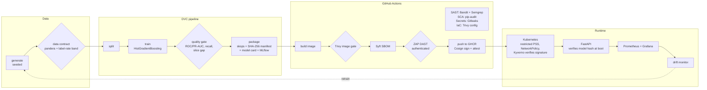
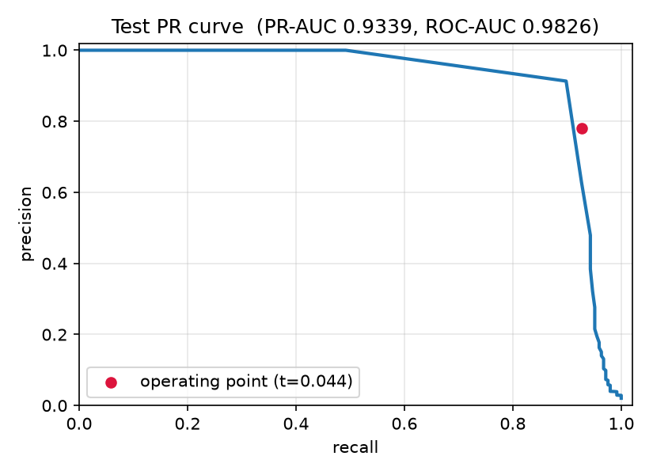
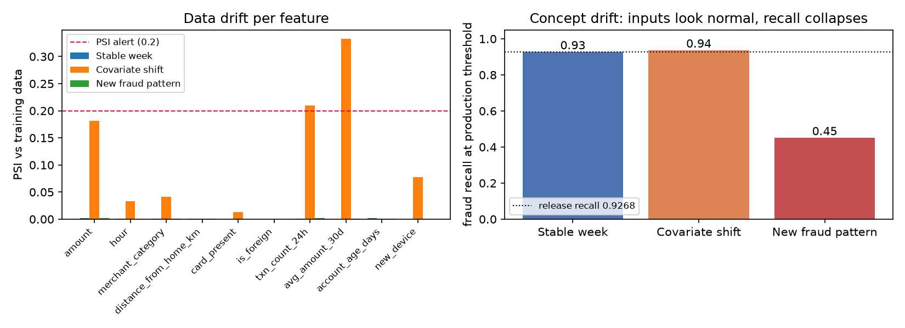

# FraudGuard

**A fraud-detection model shipped through a hardened, verifiable ML supply chain.**

[](https://github.com/kamalesansam/fraudguard/actions/workflows/ci.yml)
[](https://github.com/kamalesansam/fraudguard/actions/workflows/drift.yml)


The model is the easy part. FraudGuard is about everything around it. How do
you prove the model in production is the one that passed review, trained on the
data you think it was, built from code that was scanned, and that nobody can
swap it, poison it or call it without a key? Every arrow in the diagram below is
an automated, failing check.

## Highlights

- **No pickle anywhere.** Models are serialized with skops and loaded only after
  a SHA-256 check and a reviewed type allowlist. A model file that smuggles in
  `eval` or `os.system` is refused before deserialization (CWE-502).
- **Byte-for-byte reproducible model.** skops archives normally hash differently
  on every run. FraudGuard canonicalizes them, and CI retrains the model and
  fails if the SHA-256 differs from the manifest.
- **Signed and attested releases.** The exact image that passed Trivy and ZAP is
  pushed to GHCR, signed with Cosign keyless (GitHub OIDC), and carries two
  attestations: the SPDX SBOM and the model manifest (data digest, commit, gate
  metrics).
- **Every GitHub Action pinned to a commit SHA.** Mutable tags are how the March
  2026 `trivy-action` compromise (CVE-2026-33634) stole CI secrets.
- **Gates at every stage.** Data contract, model quality gate, SAST, SCA,
  secrets, IaC, image CVEs, DAST. Any failure stops the release.
- **Drift monitoring that catches what PSI misses.** A simulated new fraud
  pattern leaves every input distribution unchanged while recall drops from 0.93
  to 0.45. Label-based concept-drift checks catch it.

## Architecture



## Results

All numbers come from `dvc repro` on the committed `params.yaml` (seed 42, 60,000
synthetic transactions, 2.05% fraud).

### Quality gate (held-out test split, 12,000 transactions)

| Metric | Value | Gate |
|---|---|---|
| ROC-AUC | 0.983 | >= 0.95 |
| PR-AUC | 0.934 | >= 0.70 |
| Recall at threshold | 0.927 | >= 0.55 |
| Precision at threshold | 0.781 | target 0.80 on validation |
| Recall, card present / not present | 0.782 / 0.994 | gap <= 0.30 |

228 of 246 frauds caught, 64 false alarms out of 11,754 legitimate transactions.



### Drift monitoring

Three simulated production weeks scored against the released model:

| Batch | Drifted features (PSI > 0.2) | Score PSI | Recall | Alert |
|---|---|---|---|---|
| Stable week | 0 / 10 | 0.001 | 0.927 | no |
| Covariate shift (inflation, more online and night traffic) | 2 / 10 | 0.063 | 0.936 | **yes**, data drift |
| New fraud pattern (mimics normal daytime spend) | 0 / 10 | 0.003 | **0.451** | **yes**, concept drift |

The third row is the one that matters. Feature-drift dashboards stay green
while half the fraud walks through. Only the label-based check catches it.



### Security scan results (current build)

| Check | Result |
|---|---|
| Bandit (medium+) | 0 findings |
| Semgrep `p/python` + 6 custom ML rules | 0 findings (157 rules) |
| pip-audit, serving dependencies | 0 known vulnerabilities |
| Trivy image, fixable HIGH/CRITICAL | 0 |
| OWASP ZAP API scan (authenticated) | 0 warnings, 0 failures, 122 rules passed |
| Tests | 52 passed, 94% coverage |

## Supply-chain controls

| Stage | Threat | Control | Blocks the release when |
|---|---|---|---|
| Data | Label poisoning, broken joins, schema drift | pandera contract, label-rate band, duplicate check | any rule fails |
| Train | Under-performing or biased model | Quality gate incl. per-channel recall gap | a metric misses its threshold |
| Artifact | Tampered model, pickle RCE | skops + type allowlist + SHA-256 manifest | hash mismatch or unreviewed type |
| Reproducibility | Can't prove how a model was made | DVC lockfile, MLflow run, retrain-and-compare in CI | retrained hash differs |
| Code | Injection, unsafe deserialization | Bandit, Semgrep incl. custom ML rules | any medium+ finding |
| Dependencies | Known CVEs | pip-audit (serving deps: zero exceptions), Dependabot | any unaccepted vuln |
| Secrets | Leaked credentials | Gitleaks over full history, pre-commit hook | any secret |
| IaC | Privileged pods, missing limits | Trivy config on Dockerfile, k8s, compose | HIGH/CRITICAL misconfig |
| Image | OS/library CVEs | Trivy image scan, pip/setuptools stripped from runtime | fixable HIGH/CRITICAL |
| Running API | Auth bypass, injection, info leaks | ZAP API scan with injection rules set to FAIL | any WARN or FAIL |
| Release | Unsigned or swapped image | Cosign keyless signature + SBOM and model-manifest attestations | signing or verification fails |
| Cluster | Image from anywhere else | Kyverno `verifyImages` policy (reference config) | signature or attested PR-AUC missing |

Full threat model with STRIDE, OWASP and NIST AI RMF mapping:
[`docs/threat-model.md`](docs/threat-model.md).

## Hardened inference API

- API keys stored only as SHA-256 digests, compared in constant time. With no
  keys configured the API rejects everything (fail closed).
- Per-key token-bucket rate limit; scores rounded to 4 decimals.
- Strict pydantic schema: unknown fields, wrong types, NaN/inf and
  out-of-range values all return 422, and the submitted value is never echoed
  back.
- 64 KB body cap, security headers on every response, OpenAPI docs off by
  default, no `Server` header.
- Refuses to start if the model hash does not match the manifest.
- Container: non-root UID 10001, read-only root filesystem, all capabilities
  dropped, no package managers, base images pinned by digest.
- Kubernetes: restricted Pod Security, default-deny NetworkPolicy (no egress
  except DNS), no service-account token, HPA, PDB.

## Quickstart

Requires [uv](https://docs.astral.sh/uv/) and Python 3.11. Docker is optional.

```bash
make install        # uv sync --all-extras from uv.lock
make test           # 52 tests
make pipeline       # dvc repro: generate -> validate -> split -> train -> gate -> package
make drift-demo     # three simulated production weeks through the drift monitor
make security       # Bandit, Semgrep, pip-audit
make serve          # API on :8000, demo key "local-dev-key"
```

Score a transaction:

```bash
curl -s localhost:8000/v1/predict \
  -H 'X-API-Key: local-dev-key' -H 'content-type: application/json' \
  -d '{"amount": 899.0, "hour": 3, "merchant_category": "electronics",
       "distance_from_home_km": 420.0, "card_present": false, "is_foreign": true,
       "txn_count_24h": 8, "avg_amount_30d": 55.0, "account_age_days": 120,
       "new_device": true}'
# {"fraud_score":0.9982,"is_fraud":true,"request_id":"...","threshold":0.043917,"model_version":"1.0.0"}
```

Full local stack with Prometheus and Grafana (dashboard and alert rules
pre-provisioned):

```bash
make up             # API :8000, Prometheus :9090, Grafana :3000
```

Verify a published image (needs cosign v3+; signatures are stored as OCI
referrers in the Sigstore bundle format, which cosign v2 does not read):

```bash
cosign verify ghcr.io/kamalesansam/fraudguard:latest \
  --certificate-identity-regexp '^https://github.com/kamalesansam/fraudguard/' \
  --certificate-oidc-issuer https://token.actions.githubusercontent.com
```

## Project layout

```
src/fraudguard/
  data/generate.py      seeded synthetic transactions (+ drift / concept-drift modes)
  data/validate.py      pandera data contract + dataset-level checks
  features.py           single feature implementation shared by train and serve
  train.py evaluate.py  model, threshold selection, quality gate
  integrity.py          skops canonicalization, allowlist, verified loading
  package.py            manifest, model card, MLflow logging
  monitor/drift.py      PSI, KS, prediction drift, concept drift
  serve/                FastAPI app, auth + rate limiting, schemas
dvc.yaml params.yaml    reproducible pipeline definition
.github/workflows/      ci.yml (secure delivery), drift.yml (weekly monitor)
.semgrep/               custom ML supply-chain rules + rule tests
k8s/                    kustomize base + prod overlay, Kyverno signature policy
deploy/                 Argo CD application (GitOps)
monitoring/             Prometheus config + alert rules, Grafana dashboard
security/               accepted-risk register for pipeline-only CVEs
docs/threat-model.md
```

## Course mapping (DevSecMLOps, 22CSE788)

| Unit | Where it shows up |
|---|---|
| I. Foundations | DevOps + security + ML lifecycle as one pipeline; model card; ML lifecycle stages each with an automated control |
| II. Data and pipeline automation | Data validation, DVC versioning and pipeline, MLflow tracking, shared feature pipeline, metadata in the manifest |
| III. Secure CI/CD for ML | CI/CD/CT in GitHub Actions, model packaging, Docker, Kubernetes, IaC, GitOps with Argo CD, shift-left (pre-commit), secrets, dependency and vulnerability scanning |
| IV. DevSecOps for AI/ML | Threat model, OWASP Top 10 mapping, SAST/DAST/SCA (Bandit, Semgrep, ZAP, pip-audit, Trivy), secure container images, IAM-style least privilege in CI and cluster |
| V. Monitoring and governance | Deployment strategy (rolling, digest-pinned), data and concept drift, Prometheus/Grafana observability, alerting, NIST AI RMF mapping, feedback loop to retraining |

## Design notes and limitations

- **Synthetic data.** Real fraud datasets are either PCA-anonymised or
  licence-gated, which breaks reproducibility. The generator has three fraud
  archetypes plus 1% label noise, so metrics are realistic but not real-world
  claims.
- **Reproducible hash scope.** The model hash reproduces on the same platform
  and lockfile. CI retrains on the same runner image it trained on.
- **Accepted risks.** Two CVEs in pipeline-only transitive dependencies (dvc,
  evidently) have no fixed release. They are documented with review dates in
  [`security/pip-audit-ignore.txt`](security/pip-audit-ignore.txt). The serving
  image is audited with zero exceptions.
- **Reference configs.** The Kyverno policy and Argo CD application are not
  exercised in CI.
- **Adversarial robustness** is out of scope here. See the companion project
  [Aegis-ML](https://github.com/kamalesansam/aegis-ml) for evasion, poisoning
  and model-extraction attacks and defenses.

## References

- Sculley et al., *Hidden Technical Debt in Machine Learning Systems*, NeurIPS 2015
- Kreuzberger et al., *Machine Learning Operations (MLOps): Overview, Definition, and Architecture*, IEEE Access 2023
- Google Cloud, *MLOps: Continuous delivery and automation pipelines in machine learning*
- NIST, *AI Risk Management Framework (AI RMF 1.0)*, NIST AI 100-1
- OWASP Top 10 (2021) and OWASP Machine Learning Security Top 10
- GHSA-69fq-xp46-6x23 / CVE-2026-33634, trivy-action tag compromise
