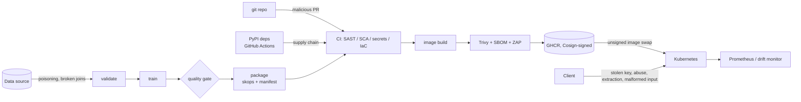

# FraudGuard threat model

Scope: the path from raw data to a prediction served in production, and every
system that can change what the model does along the way.

## Assets

| Asset | Why it matters |
|---|---|
| Training data | Poisoned or broken data produces a model that misses fraud |
| Model artifact (`model.skops`) | Tampering changes decisions; unsafe formats turn the file into code execution |
| Source code and pipeline definitions | Control what gets trained and shipped |
| Third-party dependencies and GitHub Actions | Run with the pipeline's privileges |
| Container image | What actually runs in production |
| API keys | Gate access to scores (and to model-extraction probing) |
| CI credentials (`GITHUB_TOKEN`, OIDC identity) | Can publish and sign images |

## Attack surface

## Threats and controls (STRIDE + ML-specific)

Risk = likelihood x impact, each 1 (low) to 3 (high).

| # | Threat | STRIDE / OWASP | L | I | Risk | Control | Where |
|---|---|---|---|---|---|---|---|
| T1 | Tampered model file executes code on load | Tampering, Elevation / A08 | 2 | 3 | 6 | skops instead of pickle, type allowlist, refuse unknown types | `src/fraudguard/integrity.py` |
| T2 | Model swapped between CI and production | Tampering / A08 | 2 | 3 | 6 | SHA-256 in manifest checked at startup (fail closed); Cosign keyless signature; Kyverno admission policy | `serve/app.py`, `ci.yml` publish job, `k8s/policy/` |
| T3 | Compromised GitHub Action steals CI secrets (CVE-2026-33634 pattern) | Tampering, Info disclosure / A08 | 2 | 3 | 6 | Every action pinned to a full commit SHA; least-privilege `permissions`; `persist-credentials: false`; Dependabot for SHA bumps | `.github/workflows/*.yml` |
| T4 | Vulnerable dependency in the serving image | Elevation / A06 | 3 | 2 | 6 | pip-audit (no exceptions for serving deps), Trivy image gate, Dependabot, pip/setuptools removed from runtime | `ci.yml` sca + container jobs, `Dockerfile` |
| T5 | Label poisoning or broken upstream join | Tampering / ML data poisoning | 2 | 3 | 6 | pandera data contract + label-rate band + duplicate check before training | `data/validate.py` |
| T6 | Under-performing model reaches production | (quality) | 2 | 2 | 4 | Quality gate on ROC-AUC, PR-AUC, recall and slice-recall gap; `package` refuses a failed gate | `evaluate.py`, `dvc.yaml` |
| T7 | Secrets committed to git | Info disclosure / A07 | 2 | 3 | 6 | Gitleaks on full history in CI and pre-commit; API keys stored only as SHA-256 digests | `ci.yml` secrets job, `serve/security.py` |
| T8 | Unauthenticated scoring or key brute force | Spoofing / A01, A07 | 3 | 2 | 6 | API key required on all `/v1` routes, constant-time digest compare, fail closed with no keys, auth-failure alert | `serve/security.py`, `monitoring/alerts.yml` |
| T9 | Model extraction / scraping via high-volume queries | Info disclosure / OWASP ML05 | 2 | 2 | 4 | Per-key token-bucket rate limit, scores rounded to 4 dp, rate-limit alert | `serve/security.py`, `serve/app.py` |
| T10 | Injection or malformed payloads | Tampering / A03 | 2 | 2 | 4 | Strict pydantic schema (`extra=forbid`, strict types, bounds, no NaN/inf), body size cap, input never echoed in errors, ZAP DAST in CI | `serve/schemas.py`, `serve/app.py`, `.zap/rules.tsv` |
| T11 | Container breakout or lateral movement | Elevation / A05 | 1 | 3 | 3 | Non-root UID, read-only rootfs, all capabilities dropped, seccomp RuntimeDefault, no SA token, default-deny NetworkPolicy, restricted Pod Security | `Dockerfile`, `k8s/base/` |
| T12 | Silent accuracy loss from drift | (reliability) / OWASP ML08 | 3 | 2 | 6 | PSI data drift, score-distribution drift, label-based concept drift, weekly drift workflow, flag-rate alert | `monitor/drift.py`, `drift.yml`, `monitoring/alerts.yml` |
| T13 | Misconfigured IaC (privileged pods, missing limits) | Elevation / A05 | 2 | 2 | 4 | Trivy config scan gates Dockerfile, Kubernetes and compose files | `ci.yml` iac job |
| T14 | Cannot reconstruct how a model was produced | Repudiation | 2 | 2 | 4 | DVC lockfile, MLflow run with data/model digests, manifest with git commit, reproducible model hash checked in CI, signed manifest attestation | `dvc.lock`, `package.py`, `ci.yml` |

## NIST AI RMF mapping

| Function | How FraudGuard addresses it |
|---|---|
| Govern | Model card with intended and prohibited use; documented accepted risks with review dates; security policy |
| Map | This threat model; data contract describes what valid input looks like |
| Measure | Quality gate metrics, slice recall, drift metrics, reproducibility check |
| Manage | Gates block release; drift alerts trigger retraining; signed releases allow rollback to a known digest |

## Residual risks

- Rate limiting is in-process. Behind several replicas each pod enforces its own
  bucket; production should enforce limits at the gateway as well.
- The model is not hardened against adversarial evasion. See the companion
  project [Aegis-ML](https://github.com/kamalesansam/aegis-ml) for adversarial
  training, poisoning detection and extraction monitoring.
- Kyverno and Argo CD manifests are provided as reference configuration; they
  are not exercised in CI.
